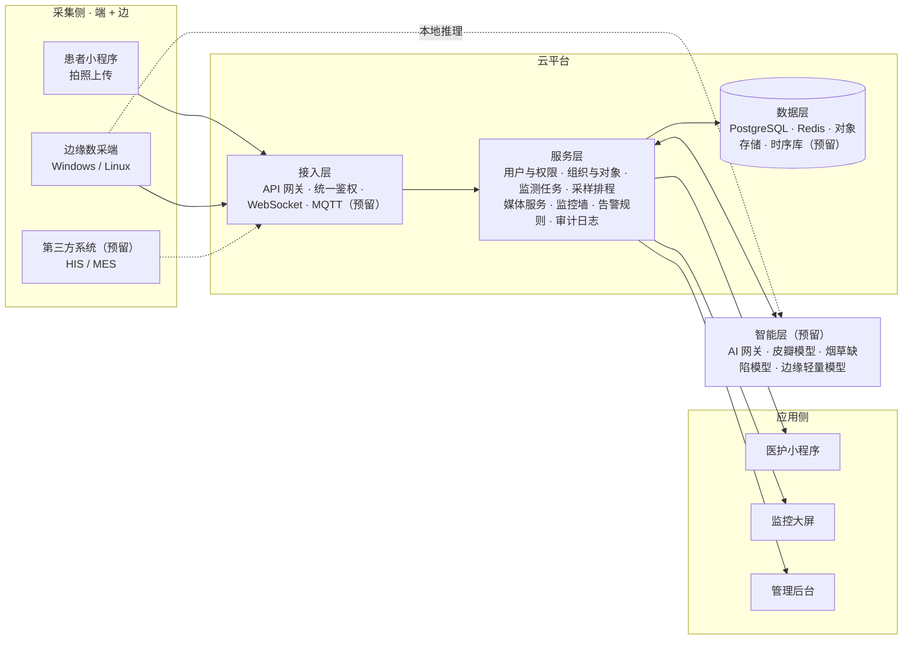
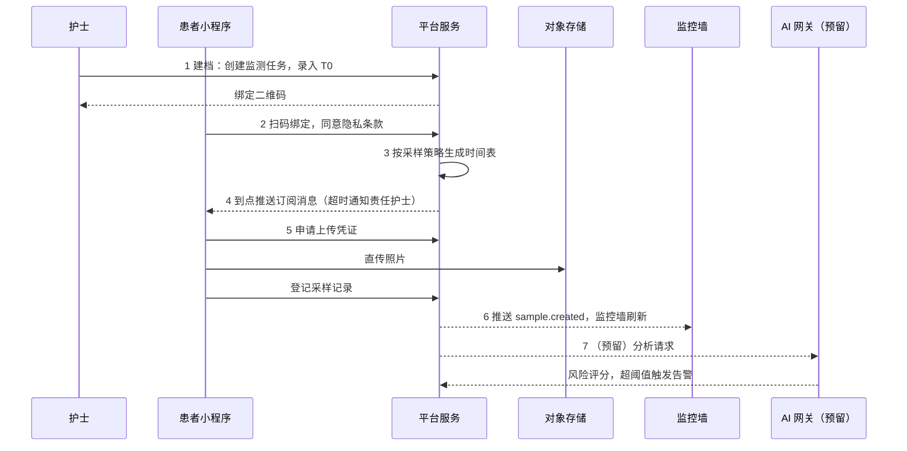
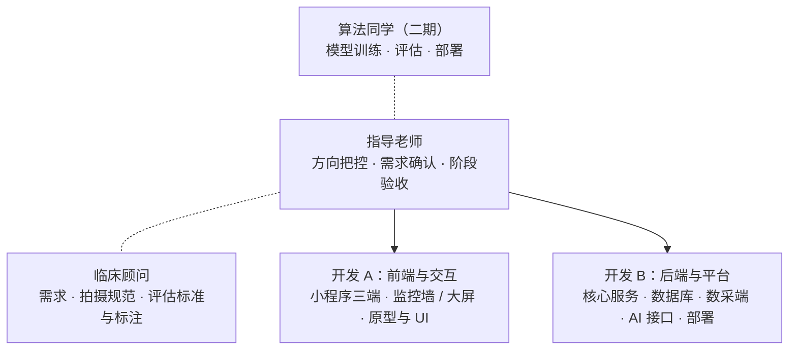

# 皮瓣状态智能辅助监测系统：系统架构与开发组织架构设计（v0.1）

> 状态：**待评审**（开发前架构评审稿）
> 配套 PPT：[`docs/ppt/皮瓣状态智能辅助监测系统-架构与开发组织-v0.1.pptx`](ppt/皮瓣状态智能辅助监测系统-架构与开发组织-v0.1.pptx)（由 [`docs/ppt/build-deck.js`](ppt/build-deck.js) 生成）

---

## 1. 背景与目标

皮瓣移植是从身体其他部位（供区）切取带血管的皮肤及皮下组织，转移覆盖创面。术后一旦出现**血管危象**而未及时处理，皮瓣可能部分或全部坏死。

| 观察指标 | 临床含义 |
| --- | --- |
| 颜色 | 苍白 → 动脉供血不足；青紫 → 静脉回流障碍 |
| 纹理 | 皮纹、皱褶、水疱与表面光泽变化 |
| 肿胀 | 肿胀程度与张力，是否进行性加重 |
| 扩展指标 | 皮温、毛细血管回流等（后续可接传感器） |

**监测频率**（以手术结束时间 T0 为起点）：

- 术后 0–72 h：每 1 小时上传 1 次（每天 24 次，共 72 次）
- 72 h 之后：每 4 小时上传 1 次（每天 6 次）

**目标**

1. 一期：微信小程序，让患者按时上传创面照片，医护可随时查看历史与实时状态。
2. 二期：接入 AI 模型，对颜色、纹理、肿胀做辅助判读与预警。
3. 三期：把平台抽象为通用的“边缘—云”监测底座，复用到烟草在线监测等工业场景（**一物多用**）。

## 2. 用户与功能

| 角色 | 定位 | 核心功能 | 核心诉求 |
| --- | --- | --- | --- |
| 患者 / 家属 | 数据提供方 | 扫码绑定监测任务；按提醒拍照上传；查看本人记录与下次时间；超时补传 | 操作简单，3 步完成上传 |
| 医生 / 护士 | 数据使用方 | 查看负责患者的**全部历史图像**；**实时监控墙**一屏总览所有患者；时间轴对比、评估标注、处置记录；接收超时与（预留）AI 预警 | 一眼看出谁有异常 |
| 管理员 | 系统运维方 | 新增 / 停用用户并分配角色与科室；配置采样策略模板；登记数采端设备；查看审计日志 | 账号与配置可控、可追溯 |

预留扩展：AI 实时分析、床旁摄像头实时视频、更多角色（护士长 / 科研人员 / 质检员）、工业场景接入。

## 3. 设计原则

1. **平台 + 领域包**：核心平台与业务解耦，医疗、烟草各是一个可插拔的领域包。
2. **配置驱动**：采样频率、术语、表单、告警规则都写成配置，不写死在代码里。
3. **接口先行**：先定 OpenAPI 契约，前端、后端、数采端、AI 四方并行开发。
4. **边云协同**：边缘就近采集、缓存、预处理；云端集中存储、调度、展示。
5. **事件驱动**：“新采样到达”等事件进入消息总线，AI、告警、大屏按需订阅。
6. **安全合规**：医疗影像属敏感个人信息；最小权限、全程加密、操作留痕。

## 4. 总体架构：端 · 边 · 云 · 智



说明：患者端与医护端是**同一个小程序**，图中按数据流向分开画。

## 5. 与工业边云监测同构（一物多用）

| 架构要素 | 皮瓣监测（医疗） | 烟草在线监测（工业） |
| --- | --- | --- |
| 监测对象 | 患者的移植皮瓣 | 烟支 / 烟包 / 设备工位 |
| 采集端 | 患者手机、床旁摄像头 | 产线工业相机、传感器、PLC |
| 边缘节点 | 病区护士站电脑（Windows） | 工控机（Windows / Linux） |
| 采样策略 | 术后 0–72 h 每 1 h，之后每 4 h | 按节拍 / 班次 / 批次 |
| 分析模型 | 颜色 · 纹理 · 肿胀 → 坏死风险 | 外观缺陷 · 尺寸 · 色差 → 质量判定 |
| 实时看板 | 病区患者监控墙 | 车间中控大屏 |
| 异常处置 | 通知医生、记录处置 | 报警、剔除、工艺调整 |
| 组织层级 | 医院 → 科室 → 病区 → 床位 | 工厂 → 车间 → 产线 → 工位 |

**结论**：差异只在“领域包”（术语、表单、策略、模型、大屏模板），平台核心代码复用，目标复用率 ≥ 80%。

## 6. 通用领域模型

| 实体 | 说明 | 医疗示例 | 烟草示例 |
| --- | --- | --- | --- |
| 租户 Tenant | 数据隔离的最上层 | 医院 | 卷烟厂 |
| 组织 Org | 树形组织 | 科室 / 病区 | 车间 / 产线 |
| 监测对象 Subject | 被监测的“东西” | 患者皮瓣 | 机台 / 工位 |
| 监测任务 Task | 一段有起止的监测周期，绑定采样策略 | 术后监测周期 | 一个生产批次 |
| 采集源 Source | 产生数据的终端 | 手机 / 床旁摄像头 | 工业相机 |
| 采样 Sample | 一次采集的结果（图像 + 元数据） | 一张创面照片 | 一帧图像 |
| 分析结果 Inference | AI 或人工的判读结果 | 坏死风险评分 | 缺陷类型判定 |
| 事件告警 Alert | 需要人处理的异常 | 疑似血管危象 | 质量异常报警 |

落地方式：通用字段建表固定；领域特有字段（如皮瓣部位、手术方式）存入 PostgreSQL `JSONB` 扩展属性，并由领域包中的表单 Schema 描述，新场景无需改表结构。

## 7. 关键模块设计

### 7.1 用户端小程序（一个小程序，三套工作台）

| 工作台 | 页面 |
| --- | --- |
| 患者端 | 首页（下次上传倒计时）· 拍照上传（引导框 + 色卡，自动质检）· 我的记录 · 消息 |
| 医护端 | 监控墙（首页）· 患者列表（按病区 / 风险筛选）· 患者详情（时间轴、前后对比）· 评估标注（正常 / 可疑 / 异常） |
| 管理端 | 用户管理 · 组织与床位 · 采样策略 · 设备与审计 |

- **登录与绑定**：微信授权登录；医护账号由管理员预建，首次登录绑定微信；患者扫描护士出示的二维码绑定病例。
- **按角色路由**：登录后按角色加载菜单与页面；前端只做展示控制，权限以后端校验为准。
- **跨端复用**：uni-app（Vue 3）一套代码编译为微信小程序与 H5，监控大屏与工业 PC 浏览器可直接复用。

### 7.2 权限模型：RBAC 角色 + 数据范围

| 功能 \ 角色 | 患者 | 医护 | 管理员 |
| --- | --- | --- | --- |
| 上传图片 | 本人 | 代拍上传 | — |
| 查看历史图像 | 本人 | 负责 / 本科室 | 只读审计 |
| 实时监控墙 | — | 本科室 | 全院 |
| 评估标注 · 处置记录 | — | ✓ | — |
| 采样策略配置 | — | 本科室调整 | 全局模板 |
| 用户与角色管理 | — | — | ✓ |
| 数采端设备管理 | — | — | ✓ |

- 角色 = 权限点的组合，例如 `sample:upload`、`sample:read`、`wall:view`、`review:write`、`user:manage`、`edge:manage`。新增角色只需配置。
- 数据范围分级：本人 → 本组 → 本科室 → 全院（工业：工位 → 产线 → 全厂）。

### 7.3 核心业务流程



**数据飞轮**：医生评估标注 → 带标签数据集 → 训练 / 迭代模型 → AI 辅助提示 → 医生复核反馈。AI 只做辅助提示，诊疗判断始终由医生作出。

### 7.4 采样策略引擎

策略属于领域包配置，示例：

```json
{
  "policy": "FLAP_DEFAULT",
  "anchor": "surgeryEndTime",
  "rules": [
    { "from": "0h",  "to": "72h", "every": "1h" },
    { "from": "72h", "to": "end", "every": "4h" }
  ],
  "graceMinutes": 15,
  "escalate": ["patient", "nurse", "doctor"]
}
```

- 时间窗 ±15 分钟；超时依次提醒患者 → 责任护士 → 主治医生。
- 医生可对单个患者临时加密（如改为每 30 分钟一次）。
- 每个采样点的状态：`待上传` → `临近到期` → `已上传` / `超时`，驱动监控墙颜色。
- 提醒通道：微信订阅消息为一次性授权，每次上传成功后引导订阅下一次；备用短信 / 护士站大屏。
- 工业复用：同一引擎按节拍、班次或批次触发采集任务。

### 7.5 实时监控墙

- 4 / 9 / 16 宫格切换；每格显示最新缩略图、床号（姓名脱敏）、状态与倒计时。
- 状态色：绿 = 正常，黄 = 临近到期，红 = 超时，紫 = AI 预警（二期）；异常自动置顶。
- WebSocket 推送新图片与状态变化，秒级刷新；点击下钻到患者详情（时间轴、前后对比、评估）。
- 演进：一期为准实时快照墙；二期接入床旁摄像头实时视频（RTSP / GB28181 → WebRTC），与工业视频监控共用流媒体服务。

### 7.6 数采端（边缘代理，Windows / Linux 通用）

| 阶段 | 内容 |
| --- | --- |
| 采集驱动 | USB 摄像头、网络摄像头 RTSP、工业相机 SDK、文件夹监听、PLC / 传感器 |
| 预处理 | 模糊 / 曝光检测、重复帧去重、压缩与缩略图、时间戳水印、隐私区域遮挡 |
| 本地推理（可选） | ONNX Runtime / OpenVINO，弱网就地预警 |
| 本地缓存 | SQLite 任务队列 + 本地文件，断网自动续传，容量滚动清理 |
| 上行通道 | HTTPS 批量上传、MQTT 消息、请求签名鉴权、失败重试退避 |
| 远程管理（下行） | 设备注册、心跳上报、配置下发、远程升级（OTA）、日志回传 |

实现：Node.js 主程序 + 驱动插件（厂商 SDK 以子进程 / gRPC 封装）；部署为 Windows 服务、Linux systemd 或 Docker。

### 7.7 AI 预留接口

流程：采样入库 → 发布 `sample.created` → AI 网关（按领域 / 模型路由）→ 模型服务（HTTP / gRPC）→ 结果回写 → 规则引擎（告警 · 监控墙）。

```http
POST /ai/v1/analyze
{
  "sampleId": "S20261028-0012",
  "domain":   "medical.flap",
  "model":    "flap-risk@1.0",
  "media":    { "type": "image", "url": "<签名URL>" },
  "context":  { "hoursAfterSurgery": 26 }
}
```

```json
{
  "riskScore": 0.82, "level": "high",
  "labels":  [{ "code": "VENOUS_CONGESTION", "conf": 0.79 }],
  "metrics": { "color": 0.71, "texture": 0.40, "swelling": 0.66 },
  "modelVersion": "1.0.3"
}
```

- 同一契约同时服务皮瓣模型与烟草缺陷检测。
- 轻量模型同步返回；重模型经队列异步回调 `POST /api/v1/inferences`；边缘端可运行同一 ONNX 模型。
- 拍摄规范决定模型上限：固定距离与角度、引导框、标准色卡做颜色校正，**一期就开始规范采集**。

## 8. 技术选型

| 层次 | 选型 | 理由 |
| --- | --- | --- |
| 用户端 | uni-app（Vue 3）+ uni-ui | JavaScript 技术栈；一套代码编译微信小程序 + H5 |
| 后台 / 大屏 | Vue 3 + Vite + Element Plus + ECharts | 与小程序同属 Vue 生态 |
| 业务后端 | Node.js 20 LTS + NestJS | 模块化 + 依赖注入；守卫实现 RBAC，便于插件化 |
| 数采端 | Node.js + 驱动插件 | Windows / Linux 同一份代码 |
| 数据库 | PostgreSQL 16 | JSONB 存领域扩展字段；可加 TimescaleDB 存工业时序 |
| 缓存 / 队列 | Redis + BullMQ | 定时提醒、超时检测、异步任务 |
| 对象存储 | MinIO / 腾讯云 COS | S3 兼容，私有化与公有云切换不改代码 |
| 物联 / 流媒体（预留） | EMQX（MQTT）· ZLMediaKit | 设备消息；RTSP / GB28181 转 WebRTC |
| AI 服务（预留） | Python + FastAPI + ONNX Runtime | 模型生态在 Python，经 HTTP 与主体解耦 |
| 工程化 | Docker Compose · GitHub Actions | 单机一键部署起步，CI 自动检查 |

原则：主体 JavaScript（可渐进引入 TypeScript）；只有 AI 模型服务使用 Python，并通过 HTTP 接口与主体隔离。

## 9. 代码仓库结构（Monorepo）

```text
QingSi/
├─ apps/
│  ├─ miniapp/           微信小程序（三角色）
│  ├─ console-web/       管理后台 + 监控大屏
│  └─ edge-agent/        数采端（Win / Linux）
├─ services/
│  ├─ api-server/        核心业务服务
│  └─ ai-gateway/        AI 网关（预留）
├─ ai-models/            Python 模型服务（二期）
├─ packages/
│  ├─ shared/            常量 · 角色 · 错误码
│  └─ sdk-js/            统一 API SDK
├─ domain-packs/
│  ├─ medical-flap/      皮瓣监测领域包
│  └─ tobacco-online/    烟草在线监测（三期）
├─ deploy/               Docker Compose · Nginx
└─ docs/                 架构 · 接口 · PPT
```

`api-server` 模块划分（NestJS Module）：`auth` 认证、`user` 用户、`rbac` 权限、`org` 组织、`subject` 监测对象、`task` 监测任务、`schedule` 采样排程、`media` 媒体、`sample` 采样、`wall` 监控墙、`alert` 告警、`ai-adapter` AI 适配、`edge` 设备、`audit` 审计、`domain-pack` 领域包。

领域包内容：术语字典、表单 Schema、采样策略、告警规则、AI 模型绑定、大屏模板。

## 10. 接口契约（v1 草案）

| 模块 | 方法与路径 | 说明 | 调用方 |
| --- | --- | --- | --- |
| 认证 | `POST /api/v1/auth/wx-login` | 微信 code 换取访问令牌 | 全部角色 |
| 监测任务 | `POST /api/v1/tasks` | 建档，生成绑定二维码 | 医护 |
| 绑定 | `POST /api/v1/tasks/{id}/bind` | 患者扫码绑定 | 患者 |
| 上传凭证 | `POST /api/v1/media/upload-token` | 获取对象存储直传凭证 | 患者 / 数采端 |
| 采样 | `POST /api/v1/samples` | 登记一次采样记录 | 患者 / 数采端 |
| 历史 | `GET /api/v1/subjects/{id}/samples` | 按时间段查询历史图像 | 医护 |
| 监控墙 | `GET /api/v1/wall` + `WS /ws/wall` | 快照 + 实时事件推送 | 医护 / 大屏 |
| 评估 | `POST /api/v1/samples/{id}/reviews` | 医生评估与标注 | 医护 |
| 用户 | `POST /api/v1/admin/users` | 新增用户并分配角色 | 管理员 |
| 设备 | `POST /api/v1/edge/heartbeat` | 心跳上报、拉取配置 | 数采端 |
| AI 结果 | `POST /api/v1/inferences` | 回写 AI 分析结果（预留） | AI 网关 |

事件总线（预留）：`sample.created` · `task.overdue` · `inference.done` · `alert.raised`。

图片不经过业务服务器：先申请上传凭证，再直传对象存储，最后登记采样记录；小程序与数采端走同一套接口。

## 11. 数据安全与合规

- **合规前置**：医疗健康信息属敏感个人信息，需单独同意；配置小程序《用户隐私保护指引》，数据境内存储；临床使用前完成伦理审批与知情同意。
- **访问控制**：最小权限 + 数据范围隔离，后端统一鉴权；图片私有读，按需签发短时效签名 URL；查看页叠加用户水印。
- **传输与存储**：全链路 HTTPS；数采端上行请求签名；对象存储加密；姓名、手机号脱敏展示；拍摄引导只拍创面，避免拍到面部。
- **审计与留存**：查看、下载、导出、权限变更全部留痕；明确数据保留期限与销毁流程；每日备份；后续对标网络安全等级保护。

## 12. 部署形态

| 形态 | 阶段 | 组成 | 特点 |
| --- | --- | --- | --- |
| 云端单机 | 开发 / 试点 | Nginx · api-server · PostgreSQL · Redis · MinIO（Docker Compose） | 一台云服务器、一条命令启动 |
| 医院私有化 | 正式上线 | 院内应用服务器 · 院内数据库与存储 · 病区边缘节点 · 安全网关 · HIS 对接（预留） | 数据不出医院内网 |
| 工业现场 | 烟草复用 | 中心云平台 · MQTT Broker · 厂区边缘工控机集群 · 工业相机 / PLC / 传感器 · MES 对接（预留） | 边缘断网自治、多厂区多租户 |

## 13. 开发组织架构



| 工作项 | 主责 | 协作 | 评审 |
| --- | --- | --- | --- |
| 需求梳理与原型 | 开发 A | 临床顾问 | 指导老师 |
| 接口契约（OpenAPI） | 开发 B | 开发 A | 双人互审 |
| 小程序三端 · 监控墙 | 开发 A | 开发 B | 临床顾问 |
| 后端服务 · 数据库 | 开发 B | 开发 A | 指导老师 |
| 数采端 · AI 接口预留 | 开发 B | 开发 A | 指导老师 |
| 拍摄规范 · 评估标准 | 临床顾问 | 开发 A | 指导老师 |
| 测试 · 部署 · 文档 | 双人 | — | 指导老师 |
| 阶段验收 | 指导老师 | 双人 | — |

协作规范：feature 分支开发，PR 互审后合并；两周一个迭代、每周例会；接口变更先改 `docs` 再改代码；ESLint + Prettier、核心单测、CI 检查；GitHub Issues / Projects 跟踪任务。

## 14. 路线图

| 周 | 工作包 |
| --- | --- |
| W1–W2 | 架构评审 · 原型 · 接口契约（**M1 架构冻结**） |
| W2–W3 | 工程脚手架 · 登录与角色 |
| W3–W5 | 建档绑定 · 拍照上传（**M2 核心流程跑通**） |
| W4–W6 | 历史查看 · 监控墙 |
| W5–W7 | 采样提醒 · 管理后台 · 审计 |
| W7–W8 | 部署联调 · 科室试点（**M3 科室试点**） |

- 一期 · MVP（约 8 周）：三角色小程序 · 监控墙 · 采样提醒
- 二期 · 智能化：标注数据集 · AI 模型 · 实时视频
- 三期 · 平台化复用：抽取领域包 · 烟草在线监测试点

## 15. 主要风险与应对

| 等级 | 风险 | 影响 | 应对 |
| --- | --- | --- | --- |
| 高 | 小程序医疗类目需资质；实时音视频组件仅对部分类目开放 | 正式版无法上线 | 课题期先用体验版；由医院主体申请类目；实时视频先放 Web 端 |
| 中 | 订阅消息需用户逐次授权 | 提醒漏发 | 每次上传后引导订阅下次；超时升级至护士站；短信兜底 |
| 高 | 照片光照、角度、距离不一致 | 人工判读与 AI 精度下降 | 引导框 + 标准色卡 + 自动质量检测 |
| 高 | 敏感数据泄露 | 合规与伦理风险 | 权限隔离、加密、审计；伦理审批与知情同意 |
| 中 | 两人团队人力有限 | 进度延误 | 严控 MVP 范围；接口先行并行开发；复用成熟组件 |
| 中 | 需求变化、跨场景扩展 | 返工 | 领域包 + 配置驱动，变化收敛在配置层 |

> 小程序类目、订阅消息与音视频组件的开放范围以微信官方最新规则为准，立项时需再次核实。

## 16. 待确认事项与下一步

**需要老师确认**

1. 小程序注册主体（个人 / 学校 / 医院）与上线方式
2. 试点科室、床位规模与参与医护人数
3. 一期是否需要床旁摄像头，还是仅患者手机拍照
4. 数据存放：公有云，还是医院内网
5. 伦理审批与患者知情同意由谁牵头

**下一步（评审通过后 2 周内）**

- 冻结一期范围与验收标准
- 输出交互原型与 OpenAPI v1 接口文档
- 搭建 Monorepo、开发环境与 CI
- 与临床顾问确定拍摄规范与评估量表
